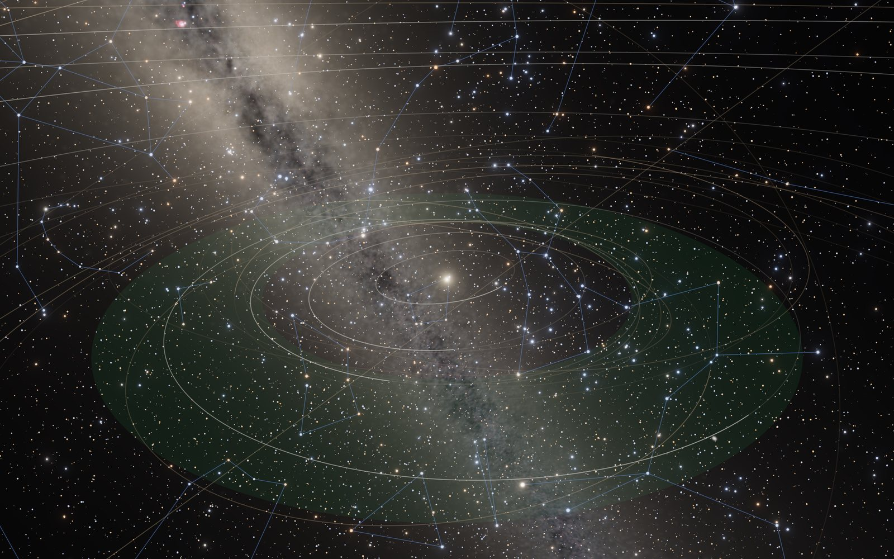

# Atlante Celeste

Un simulatore 3D del Sistema Solare in tempo reale, pensato per crescere fino alla Via Lattea.

*English: [README.md](README.md)*



Pianeti, lune, pianeti nani, comete, decine di migliaia di asteroidi, le sonde nello spazio profondo e migliaia di satelliti attorno alla Terra, ognuno nella sua posizione reale **in questo istante**, con le coordinate che scorrono dal vivo, i dati fisici e una scheda con scienza, storia e curiosità.

L'interfaccia e le schede sono in **italiano, inglese, spagnolo, tedesco e francese** (menu in alto a destra, accanto a «?»).

## Avvio

### Su Windows

**La prima volta**: doppio clic su **`avvia.bat`**. Prepara Python e le librerie (qualche minuto) e apre Atlante Celeste nella **sua finestra**, come un normale programma.
Poi doppio clic su **`crea_collegamento.bat`**: mette l'icona di Atlante Celeste sul Desktop e nel menu Start.

**Le volte successive**: apri l'icona sul Desktop. Il programma parte senza la finestra nera della console; per chiuderlo basta chiudere la sua finestra.

Altri modi di avvio:
- `avvia.bat browser`: interfaccia in una scheda del browser (`http://127.0.0.1:8765`) invece che nella finestra;
- `sviluppo.bat`: per modificare il codice, con ricarica automatica.

Se la finestra nativa non riesce ad aprirsi (per esempio se manca il componente WebView2 di Windows), il programma passa da solo al browser.

### Sul Mac

**La prima volta**: apri il Terminale e scrivi `bash ` seguito dal percorso di **`installa_mac.command`** (puoi trascinare il file nella finestra del Terminale), poi Invio. Per esempio, se la cartella è in Download:

```
bash ~/Downloads/AtlanteCeleste/installa_mac.command
```

Lo script sposta il progetto in `~/Progetti/AtlanteCeleste` (se era in Download, Scrivania o Documenti, che il Mac protegge e iCloud sincronizza), installa uv se manca, prepara Python e crea l'app **Atlante Celeste** fra le Applicazioni, con la sua icona. Non cancella nulla e si può rieseguire (per esempio se sposti la cartella).

**Le volte successive**: apri Atlante Celeste dalle Applicazioni, dal Launchpad o con Spotlight. Per tenerlo nel Dock, trascina l'app dalla cartella Applicazioni al Dock.

Altri modi di avvio: `bash avvia.command` (finestra) e `bash avvia.command browser` (scheda del browser). Schermo intero: Ctrl+Cmd+F o il pulsante verde della finestra; per avvicinarti puoi anche pizzicare il trackpad.

### Dati

Al primo avvio il programma scarica i dati da NASA/JPL e CelesTrak (qualche minuto per tutto). Poi li conserva in `data/cache`: se manca la rete, usa quelli salvati.

Facoltativo: Wikipedia chiede ai programmi un recapito. Se vuoi, imposta la variabile d'ambiente `ATLANTE_CONTACT` con la tua email: viene inviata solo ai servizi pubblici da cui il programma scarica i dati (Wikipedia, JPL, CelesTrak). Senza, i riassunti di Wikipedia li scarica direttamente la finestra del programma.

Requisiti (gli script di avvio installano uv da soli se manca):
- [uv](https://docs.astral.sh/uv/) (gestisce Python e le librerie del server)
- [Node.js](https://nodejs.org/) (serve solo per ricompilare l'interfaccia)

## Comandi

| Azione | Comando |
|---|---|
| Ruotare la vista | trascina con il mouse |
| Avvicinarsi / allontanarsi | rotella |
| Selezionare un corpo | clic (sul corpo o sul suo nome) |
| Volare fino a un corpo | doppio clic, oppure tasto **F** |
| Cercare | tasto **/** |
| Pausa del tempo | **Spazio** |
| Rallentare / accelerare (anche all'indietro) | **,** e **.** |
| Tornare a "adesso" | **N** |
| Tornare al Sole | **S** |
| Livelli (cosa mostrare) | **L** |
| Nascondere l'interfaccia | **H** |
| Schermo intero | **F11** |
| Guida dei comandi | **?** |
| Volo libero (sì / no) | **V** oppure il pulsante **Volo** in alto |
| Campo magnetico del corpo selezionato (pianeti, Ganimede, Sole) | **M** |
| Eventi in cielo | **E** oppure il pulsante **Eventi** |
| Via Lattea | **G** |
| Cielo visto da terra (sì / no) | **T** oppure il pulsante **Cielo** in alto |
| Fotografare la scena | **P** oppure il pulsante **Foto** (le immagini vanno nella cartella `immagini`) |

### Volo libero

Con **V** (o il pulsante **Volo**) la camera smette di girare attorno a un corpo e si muove come un'astronave:
**W A S D** (o le frecce) per avanti, sinistra, indietro e destra, **Q** ed **E** per scendere e salire, il mouse
trascinato per guardarsi intorno, la rotella per una spinta in avanti o indietro, **Shift** per andare cinque volte
più veloci, **+** e **−** per raddoppiare o dimezzare la velocità, **Z** e **C** per ruotare su se stessi, **R** per
raddrizzare la vista. La velocità si adatta da sola alla distanza dalla superficie più vicina: piano vicino a un
asteroide, velocissimi fra le stelle, e non ci si schianta mai. In volo libero **S** ed **E** muovono la camera:
il Sole e gli eventi si raggiungono dalla ricerca e dal pulsante **Eventi**. Con **F**, il doppio clic o la ricerca
si vola fino a un corpo e si torna a girargli attorno; con **V** si torna all'orbita attorno al corpo più vicino.

Cliccando sulla data in basso puoi saltare a qualsiasi momento fra il 1600 e il 2500.

## Da dove arrivano i dati

| Cosa | Fonte | Come |
|---|---|---|
| Sole, pianeti, lune, sonde, corpi notevoli | [NASA/JPL Horizons](https://ssd.jpl.nasa.gov/horizons/) | vettori di posizione e velocità, interpolati (Hermite) a 60 fps |
| Asteroidi e comete (decine di migliaia) | [JPL Small-Body Database](https://ssd.jpl.nasa.gov/tools/sbdb_query.html) | elementi orbitali, calcolati sulla scheda video |
| Passaggi ravvicinati alla Terra | [JPL CNEOS](https://cneos.jpl.nasa.gov/ca/) | tabella nella scheda dei NEO e pannello Eventi |
| Eclissi, opposizioni, fasi, stagioni | [Astronomy Engine](https://github.com/cosinekitty/astronomy) (MIT) | calcolati nel programma, anche senza internet |
| Piogge di meteore | [International Meteor Organization](https://www.imo.net/) | massimi calcolati dalla longitudine del Sole |
| Satelliti terrestri | [CelesTrak](https://celestrak.org/) | elementi OMM + modello SGP4 |
| Stelle (circa 110.000) | [HYG Database v4.1](https://github.com/astronexus/HYG-Database) (CC BY-SA 4.0) | posizioni 3D reali in parsec |
| Texture dei pianeti e di Urano | [Solar System Scope](https://www.solarsystemscope.com/textures/) (CC BY 4.0) | scaricate al primo uso (in alta risoluzione se la scheda video la regge) |
| Foto di nebulose, ammassi e galassie | [Stellarium](https://github.com/Stellarium/stellarium) (crediti dei singoli autori nella scheda) | incluse nel progetto (`data/assets/dso`), da `scripts/prepara_texture_cielo_profondo.py` |
| Orbite delle stelle S attorno a Sgr A* | Gillessen et al. 2017, ApJ 837, 30 | elementi orbitali nel catalogo |
| Texture di Nettuno, 35 lune, pianeti nani e asteroidi | [Celestia](https://github.com/CelestiaProject/CelestiaContent), da immagini di Voyager, Galileo, Cassini, New Horizons, Dawn... | incluse nel progetto (`data/assets/textures`); autori e licenza nella scheda di ogni corpo |
| Texture di Plutone e Caronte | NASA, sonda New Horizons | incluse nel progetto, preparate da `scripts/prepara_texture_libere.py` |
| Campi magnetici | WMM2025/IGRF-14, JRM09, Cassini, Voyager 2, MESSENGER, Galileo… | la fonte di ogni valore è nella scheda del corpo |
| Orientamento dei pianeti | modelli IAU WGCCRE | il lato illuminato della Terra è quello vero |
| Schede testuali | scritte per questo progetto | `data/content/<lingua>/*.md` |
| Testi per corpi senza scheda | Wikipedia, nella lingua scelta | riassunto e collegamento |

La barra in basso a sinistra dice sempre da dove arriva ogni posizione: se un corpo è ancora in attesa dei dati JPL viene mostrato con un modello approssimato, e la scheda lo segnala.

## Struttura del progetto

```
atlante-celeste/
├── avvia.bat             avvio per l'uso normale (Windows)
├── avvia.command         avvio sul Mac
├── installa_mac.command  installazione sul Mac: crea l'app fra le Applicazioni
├── sviluppo.bat          avvio con ricarica automatica (per modificare il codice)
├── backend/              server dati locale (Python, FastAPI)
│   └── atlante/
│       ├── main.py         indirizzi /api/...
│       ├── ephemeris.py    effemeridi a blocchi da 32 giorni, con cache
│       ├── cache.py        cache SQLite con scadenza e uso offline
│       └── sources/        un modulo per ogni fonte (Horizons, SBDB, CelesTrak, Wikipedia, texture)
├── frontend/             interfaccia 3D (TypeScript + Three.js)
│   └── src/
│       ├── core/           tempo, unità, sistemi di riferimento, formattazione, traduzioni
│       ├── ephem/          Keplero, interpolazione JPL, modelli di rotazione IAU
│       ├── sim/            l'albero dei corpi e il loro stato
│       ├── render/         grafica: shader, camera, orbite, stelle, asteroidi, satelliti
│       ├── ui/             pannelli, ricerca, tempo, livelli
│       └── i18n/           traduzioni dell'interfaccia
├── data/
│   ├── catalog/          i corpi in JSON: ID, gerarchia, dati fisici, rotazione, comandi JPL
│   ├── catalog_i18n/     traduzioni del catalogo
│   ├── content/<lingua>/ le schede in Markdown (una per corpo)
│   ├── reference/        nomi di stelle e costellazioni, luoghi sulle superfici
│   ├── generated/        catalogo stellare preprocessato
│   ├── assets/textures/  mappe di lune e asteroidi incluse (con manifest.json: autori e licenze)
│   ├── cache/            dati scaricati (si ricrea da solo)
│   └── textures/         texture scaricate (si ricreano da sole)
├── scripts/              strumenti di preparazione dati
└── docs/                 ARCHITETTURA.md (le scelte tecniche), LINGUE.md (le traduzioni)
```

## Modificare o aggiungere qualcosa

**Correggere una scheda**: apri il file in `data/content/<lingua>/` (per esempio `marte.md`) e scrivi. Basta ricaricare la pagina.

**Aggiungere un corpo**: copia un elemento in uno dei file di `data/catalog/` e cambia ID, nome, genitore e comando JPL. Per esempio, per una nuova sonda basta il suo codice Horizons (lo trovi su [Horizons](https://ssd.jpl.nasa.gov/horizons/app.html) cercando il nome). Poi riavvia il server.

**Modificare la grafica**: avvia `sviluppo.bat` e modifica i file in `frontend/src`: il browser si aggiorna da solo. Quando hai finito, `npm run build` dentro `frontend` aggiorna la versione usata da `avvia.bat`.

**Controllare che tutto funzioni**: `uv run --directory backend --group dev pytest` (server) e `npm test` dentro `frontend`.

**Tradurre**: vedi `docs/LINGUE.md`; dentro `frontend`, `node tools/i18n_keys.mjs` conta le scritte che mancano in ogni lingua.

## La Via Lattea

Allontanati dal Sistema Solare (o premi **G**): oltre qualche migliaio di anni luce compare la **Via Lattea vista da fuori**, con il bulge, la barra, i bracci a spirale e le corsie di polvere. Non è una fotografia (nessuno l'ha mai vista da fuori): è un modello costruito sui dati scientifici, con i bracci misurati da Reid e collaboratori (2019) e il centro galattico, Sagittarius A*, alla distanza misurata dallo strumento GRAVITY (2021). Lo stesso modello, visto dalla Terra, disegna in cielo la fascia della Via Lattea con le sue zone scure. E si può guardare anche **da Andromeda**: a 765.000 parsec la nostra Galassia è una piccola spirale.

Si possono selezionare e visitare: **Sagittarius A\*** (da lontano si vede come nell'immagine dell'Event Horizon Telescope; allontanati di qualche centinaio di UA e vedrai le **stelle S**, 22 stelle con le orbite vere misurate dall'ESO, S2 compresa; da vicino vedi il paragrafo qui sotto), i bracci a spirale, nebulose (Orione, Aquila, Carena, Laguna, Trifida), ammassi (Pleiadi, Iadi, Omega Centauri, M13, M22), le **Nubi di Magellano** e la **Galassia di Andromeda**.

Nebulose, ammassi e galassie hanno **fotografie vere** (dalla raccolta del planetario Stellarium, con i crediti degli autori nella scheda), appoggiate nello spazio alla distanza giusta: viste dalla Terra coincidono con il cielo. Girandoci attorno, le **nebulose diventano nuvole in 3D** ricavate dalla foto, in cui si può entrare; le **Nubi di Magellano** diventano nuvole di stelle disposte sul loro disco inclinato, con la forma misurata (la Piccola Nube è molto allungata lungo la nostra linea di vista, e vista di lato è una striscia tenue); la foto di Andromeda resta appoggiata sul suo disco e, guardandolo di faccia, lascia il posto a un modello a spirale; gli ammassi globulari diventano decine di migliaia di stelle da attraversare, e le **Pleiadi e le Iadi** le loro centinaia di stelle, con le dimensioni e il numero di stelle misurati.

**Viaggiare nella Galassia.** Con il volo libero (**V**) ci si può allontanare dal Sole di migliaia di anni luce: la fascia della Via Lattea è calcolata dal punto in cui ti trovi (verso il centro diventa un grande bagliore dorato tagliato dalle polveri), e dove i cataloghi finiscono il programma **genera le stelle** con la densità giusta per quella zona della Galassia: più fitte verso il centro, azzurre lungo i bracci, rade sopra il disco. Ogni zona ha le sue stelle fisse: tornando nello stesso posto si ritrovano le stesse. Il riquadro del volo dice quanto sei lontano dal Sole e quanto tempo impiega la sua luce ad arrivare fin lì.

### Sagittarius A* da vicino

Avvicinandosi al buco nero l'immagine non è più un disegno: per ogni punto dello schermo il programma segue il raggio di luce nello spaziotempo curvo, secondo la relatività generale, per un buco nero **che ruota** (soluzione di Kerr). La rotazione di Sgr A* non è ancora misurata con certezza: all'inizio vale il 90% del massimo possibile e si cambia con il cursore nel riquadro (a zero il buco nero non ruota). Con la rotazione l'ombra non è più rotonda né centrata (dal lato che gira verso chi guarda la luce passa più vicino all'orizzonte), il gas arriva più vicino al buco nero e attorno all'equatore c'è l'ergosfera, dove lo spazio stesso è trascinato in tondo. Ne vengono fuori da soli l'**ombra**, 2,6 volte più larga dell'orizzonte e sempre più grande nel cielo man mano che ci si avvicina, il sottile **anello di fotoni**, il cielo deformato dalla **lente gravitazionale** (anche quello alle spalle) e il **gas caldo** che gira attorno al buco nero, più luminoso dal lato che viene verso chi guarda. Tre o quattro volte al giorno c'è un **lampo**: una macchia calda gira attorno al buco nero in circa 50 minuti, come ha osservato lo strumento GRAVITY nel 2018.

In alto a sinistra compare il riquadro **«Vicino a Sagittarius A\*»**: ridotto mostra la distanza e quanto rallenta l'orologio; con **Dettagli** dice che cosa proverebbe chi stesse fermo in quel punto (spinta dei razzi per non cadere, velocità di fuga, orbita circolare, marea, grandezza dell'ombra, prossimo lampo).

Le **fotografie** di nebulose, ammassi e galassie si fondono con il cielo attorno: il bordo è irregolare e segue la forma dell'oggetto, senza il riquadro della foto.

### Il cielo visto da terra

Con **T** (o il pulsante **Cielo**) ci si mette nel luogo dell'osservatore, quello scelto nel pannello Eventi (all'inizio Roma), e si guarda il cielo com'è davvero da lì: l'orizzonte con i punti cardinali, le **costellazioni** con le loro figure e i nomi in italiano, i pianeti luminosi come stelle, la Luna con la sua fase. Si trascina per guardarsi intorno e la rotella ingrandisce come un binocolo o un telescopio (fino a mezzo grado di campo: la Luna riempie lo schermo). Di giorno il cielo è azzurro e le stelle spariscono; al tramonto l'orizzonte si tinge d'arancio dalla parte del Sole. Togliendo la spunta a «Luce del giorno» le stelle si vedono anche con il Sole alto. Il tempo scorre come sempre: accelerandolo il cielo ruota, e **Vai** su un evento gira lo sguardo verso l'eclisse o il passaggio della Stazione spaziale. **F**, il doppio clic e la ricerca girano lo sguardo verso il corpo scelto. Le figure delle costellazioni si vedono anche dallo spazio, finché si resta nel Sistema Solare (livello «Costellazioni»).

### Esopianeti, zone e luoghi

- **Esopianeti**: all'avvio il programma scarica dal NASA Exoplanet Archive i sistemi planetari entro circa 33 anni luce e alcuni dei più famosi (TRAPPIST-1, 51 Pegasi...). Si trovano con la ricerca; la stella è nella sua posizione vera, i pianeti girano con il periodo misurato, illuminati dalla loro stella. Orbite circolari nel piano dell'eclittica e superfici indicative: l'orientamento e l'aspetto veri non si conoscono.
- **Zone e confini**: la zona abitabile attorno al Sole, la fascia di Kuiper, lo shock di terminazione e l'eliopausa (con le Voyager ormai oltre), la nube di Oort e i punti di Lagrange del sistema Sole-Terra (il telescopio Webb è attorno a L2).
- **Luoghi sulle superfici**: avvicinandosi a un corpo compaiono i nomi di mari, crateri, monti e dei punti dove sono atterrate le missioni: cento luoghi su 17 corpi (Luna, Marte, Mercurio, Venere, le lune di Giove, Titano e altre lune di Saturno, Plutone e Caronte, Cerere, Vesta). **Un clic sul nome** apre una scheda con tipo, coordinate e una breve descrizione; si chiude con Esc, con la × o cliccando altrove.
- **Misura**: nella scheda di un corpo, «Misura da qui» e poi la selezione di un altro corpo danno la distanza fra i due e il tempo che impiega la luce, con una linea che li unisce.
- **Preferiti**: il pulsante ☆ nella scheda; i preferiti compaiono aprendo la ricerca senza scrivere nulla.

Tutto si accende e si spegne dal pannello **Livelli**.

### Eventi in cielo

Il pulsante **Eventi** (tasto **E**) elenca cosa succede nei prossimi 12 mesi o 5 anni, a partire dalla data della simulazione: eclissi di Sole e di Luna (con la visibilità dal luogo che scegli nel pannello: all'inizio Roma), opposizioni dei pianeti, massime elongazioni di Mercurio e Venere, transiti, superlune, fasi lunari, equinozi e solstizi, perielio, i massimi delle piogge di meteore (con la cometa da cui nascono e il disturbo della Luna) e gli asteroidi che passeranno vicino alla Terra (NASA/JPL CNEOS, serve internet). **Vai** porta il tempo a quel momento e inquadra la scena: la Luna color rame, l'ombra della Luna sulla Terra, l'orbita della cometa madre delle Perseidi che incrocia quella della Terra.

### I colori e i tipi delle stelle

Ogni stella ha il colore della sua temperatura: azzurre le calde (classi O e B), bianche le A, gialle come il Sole le G, arancioni le K, rosse le M. Nel pannello **Livelli** si sceglie fra "colori accentuati" e il bianco quasi uniforme che vede l'occhio nudo.

Cliccando una stella, la scheda dice **che stella è** (nana rossa, nana gialla, gigante rossa, supergigante blu, nana bianca...) con temperatura, luminosità e raggio, e la colloca nel **diagramma di Hertzsprung-Russell** fra tutte le altre del catalogo. Avvicinandosi, la stella appare come una sfera del suo colore e della sua grandezza vera: Betelgeuse è più grande dell'orbita di Marte, una nana bianca è grande come la Terra. Il tipo viene dalla classe spettrale del catalogo; quando manca (molte stelle di Gaia) è stimato da colore e luminosità, e la scheda lo dice.

### Stelle a tasselli e catalogo Gaia

Le stelle ora arrivano a "tasselli" (un octree, come in Gaia Sky): si scaricano solo quelle che possono essere visibili da dove si trova la camera. Così il programma è pronto per il catalogo **Gaia DR3** dell'ESA, con milioni di stelle in più:

```
uv run --project backend --group dev python scripts/gaia_scarica.py --prova      (prova veloce)
uv run --project backend --group dev python scripts/gaia_scarica.py --gmax 12    (circa 3 milioni di stelle)
uv run --project backend --group dev python scripts/build_star_tiles.py --gaia data/sources/gaia/G12
```

Quando la cartella `data/generated/stars/gaia` esiste, Atlante Celeste usa Gaia al posto di HYG (le stelle più luminose e i nomi propri vengono comunque da HYG). Lo scaricamento si può interrompere e riprendere.

## Verso la Via Lattea (prossimi passi)

Il progetto è costruito fin dall'inizio per scalare. In breve (dettagli in `docs/ARCHITETTURA.md`):

- tutte le coordinate sono nel sistema **ICRF**, lo stesso del catalogo stellare **Gaia**: pianeti e stelle convivono senza conversioni;
- posizioni in **doppia precisione** con **origine mobile**: la scheda video riceve solo coordinate relative alla camera, quindi si passa dai metri agli anni luce senza tremolii;
- **buffer di profondità logaritmico**: un asteroide da 30 metri e una stella a 1.000 anni luce nella stessa scena;
- ogni corpo ha un **ID univoco preso dai cataloghi ufficiali** (`naif:399`, `sb:433`, `norad:25544`, `hyg:…`, domani `gaia:…`);
- i grandi cataloghi viaggiano in un **formato binario a colonne** (ATBL) già pronto per i "tasselli" di stelle che servono per i miliardi di stelle di Gaia;
- le stelle hanno già una **posizione 3D reale**: allontanandoti dal Sole il cielo cambia davvero.

### Prossime tappe possibili

Fatto: texture delle lune, eclissi e ombre, colori e tipi delle stelle, eventi in cielo, Via Lattea, app desktop, modelli 3D delle sonde, campi magnetici (pianeti, Ganimede, Sole) con l'intensità alla superficie e alla camera, scelta del luogo di osservazione, cielo visto da terra con le costellazioni, anelli di Giove, Urano e Nettuno, esopianeti, zone e confini, luoghi sulle superfici con le didascalie, misura, preferiti, fotografie, Sagittarius A* con i raggi di luce calcolati attorno a un buco nero che ruota. Ancora da fare:

1. Code delle comete anche nella nuvola di comete; modalità "corpi ingranditi"; confronto delle grandezze in 3D, con i corpi affiancati.
2. Catalogo Gaia DR3 a livelli di dettaglio: centinaia di milioni di stelle caricate per zone.

## Autore, crediti e licenze

Atlante Celeste © 2026 Giovanni Frasca. È software libero: il codice è distribuito con la licenza **GNU GPL 3.0 o successiva** (file `LICENSE`), i testi delle schede in `data/content` con la licenza **CC BY-SA 4.0** (`data/content/LICENZA.md`). Tutti i contributi (dati, immagini, software) sono elencati in `CREDITI.md`; il testo delle licenze del software di terze parti è in `LICENZE_TERZE_PARTI.txt`.

### Licenze dei dati

- Catalogo HYG: CC BY-SA 4.0, David Nash (astronexus).
- Texture dei pianeti: Solar System Scope, CC BY 4.0.
- Texture di Nettuno, lune, pianeti nani e asteroidi: progetto Celestia. Ogni mappa ha la sua licenza (CC0, CC BY, CC BY-SA, GPL), elencata con gli autori in `data/assets/textures/manifest.json` e nella scheda del corpo. Si rigenerano con `scripts/prepara_texture_lune.py`.
- Texture di Urano (Solar System Scope, CC BY 4.0), Plutone e Caronte (NASA, New Horizons): si preparano con `scripts/prepara_texture_libere.py`.
- Dati NASA/JPL e CelesTrak: pubblici, con i rispettivi termini d'uso (CelesTrak chiede di non scaricare i dati più spesso di ogni due ore: la cache lo rispetta).
