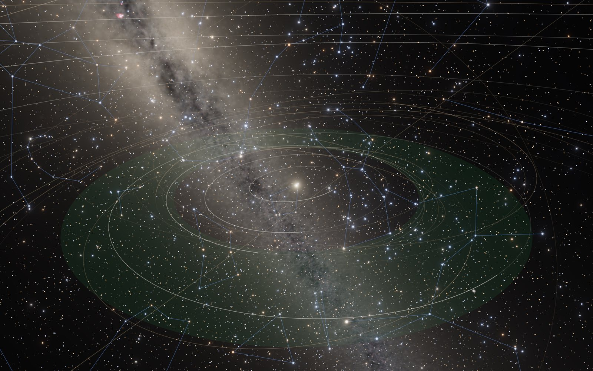
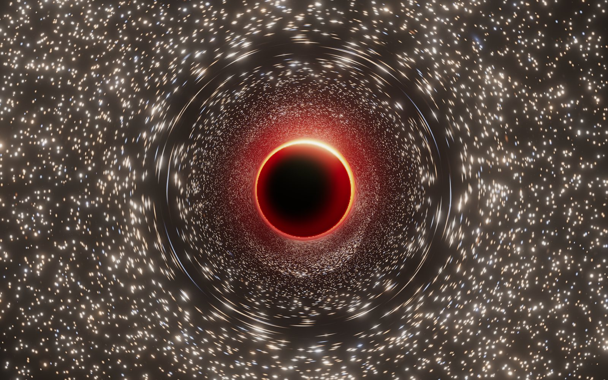

# Atlante Celeste

**A real-time 3D atlas of the Solar System, built to grow into the whole Milky Way.**

*Italiano: [README.it.md](README.it.md)*



Planets, moons, dwarf planets, comets, tens of thousands of asteroids, deep-space probes and thousands of satellites around the Earth, each one where it really is **right now**. Coordinates update live, every body has its physical data, and more than a hundred bodies have a hand-written card with science, history and curiosities.

The interface and the cards are available in **Italian, English, Spanish, German and French**.



## What you can do

- **Fly anywhere**, from the surface of an asteroid to thousands of light-years from the Sun, with no jitter: positions are kept in double precision around a floating origin.
- **Move through time** between the years 1600 and 2500, speed it up, slow it down or run it backwards.
- **See the sky from the ground**: the horizon, the constellations with their figures, the planets and the Moon with its phase, as seen from any place you choose (Rome by default).
- **Events**: solar and lunar eclipses (with visibility from your place), planetary oppositions, transits, supermoons, equinoxes and solstices, meteor-shower peaks, and asteroids passing close to the Earth. **Go** jumps to the moment and frames the scene.
- **Magnetic fields** of the planets, Ganymede and the Sun, drawn as field lines (dipoles shifted and tilted as measured). The card gives the field strength at the surface, and a live row shows the field where the camera is.
- **Stars**: about 110,000 stars in their real 3D positions (HYG), coloured by temperature, each placed on the Hertzsprung–Russell diagram. The loader works in tiles (an octree) and is ready for the ESA **Gaia DR3** catalogue.
- **The Milky Way from outside**, a model built on scientific data: bar, spiral arms measured by Reid et al. (2019), dust lanes. Nebulae, clusters and galaxies use real photographs that turn into 3D clouds of gas or stars as you fly around them; the Magellanic Clouds and Andromeda are there too.
- **Sagittarius A\* up close**: for every pixel the program follows the light ray in the curved spacetime of a **rotating (Kerr) black hole**, with the shadow, the photon ring, gravitational lensing and the hot gas around it.
- **Exoplanets** within about 33 light-years and some famous systems (TRAPPIST-1, 51 Pegasi…), from the NASA Exoplanet Archive.
- **Places on surfaces**: a hundred named seas, craters, mountains and landing sites on 17 bodies.
- **Measure** the distance between two bodies and the light travel time, keep **favourites**, take **photos** of the scene.

Everything can be switched on and off from the **Layers** panel.

## Getting started

### Ready-to-use download

If a release is available on the [Releases](../../releases) page, download the zip for your system and follow `LEGGIMI.txt` inside it (in Italian; the steps are below in English). The release already contains the compiled interface, so you don't need Node.js.

### Windows (10 or 11)

1. Unzip into a folder that is not synced with OneDrive, for example `C:\Progetti`.
2. Double-click **`avvia.bat`**. The first time it installs [uv](https://docs.astral.sh/uv/) (the tool that manages Python) and the libraries, then opens Atlante Celeste in **its own window**.
3. Double-click **`crea_collegamento.bat`** to put an icon on the Desktop and in the Start menu. From then on, just use the icon.

If Windows shows the blue "Windows protected your PC" warning, click "More info" and then "Run anyway". If the native window cannot open (for example if the WebView2 component is missing), the program opens in the browser instead.

Other ways to start it: `avvia.bat browser` (a browser tab at `http://127.0.0.1:8765`) and `sviluppo.bat` (development mode, with automatic reload).

### macOS (11 or later)

1. Open the Terminal, type `bash ` (with a space), drag **`installa_mac.command`** into the window and press Enter. For example:

   ```
   bash ~/Downloads/AtlanteCeleste/installa_mac.command
   ```

   The script moves the project to `~/Progetti/AtlanteCeleste` (Downloads, Desktop and Documents are protected by macOS and synced by iCloud), installs uv if needed, prepares Python and creates the **Atlante Celeste** app in Applications. It deletes nothing and can be run again.
2. From then on, open Atlante Celeste from Applications, Launchpad or Spotlight.

Don't double-click `installa_mac.command`: macOS blocks files downloaded from the internet. From the Terminal it always works. Other ways to start it: `bash avvia.command` (window) and `bash avvia.command browser` (browser tab).

### From source

You need [uv](https://docs.astral.sh/uv/) and [Node.js](https://nodejs.org/). The start scripts above install uv if it is missing and build the interface (`frontend/dist`) the first time if it is not there yet.

```
git clone https://github.com/ffix01001/AtlanteCeleste.git
cd AtlanteCeleste
avvia.bat                 (Windows)
bash avvia.command        (macOS)
```

Linux has not been tested yet: `bash avvia.command browser` is the best place to start, and reports are welcome.

### Data

On first start the program downloads data from NASA/JPL and CelesTrak (a few minutes). It keeps them in `data/cache`: without a network connection it uses the saved data.

Optional: Wikipedia asks programs for a contact address. If you like, set the environment variable `ATLANTE_CONTACT` to your email: it is sent only to the public services the program downloads from (Wikipedia, JPL, CelesTrak). Without it, Wikipedia summaries are downloaded directly by the program window.

## Controls

| Action | Control |
|---|---|
| Rotate the view | drag with the mouse |
| Zoom in / out | mouse wheel (or pinch on a trackpad) |
| Select a body | click (on the body or its name) |
| Fly to a body | double-click, or **F** |
| Search | **/** |
| Pause time | **Space** |
| Slow down / speed up time (also backwards) | **,** and **.** |
| Back to "now" | **N** |
| Back to the Sun | **S** |
| Layers (what to show) | **L** |
| Events | **E** or the **Events** button |
| Milky Way | **G** |
| Free flight on / off | **V** or the **Fly** button |
| Magnetic field of the selected body | **M** |
| Sky seen from the ground on / off | **T** or the **Sky** button |
| Take a photo of the scene | **P** or the **Photo** button (saved in the `immagini` folder) |
| Hide the interface | **H** |
| Full screen | **F11** (on a Mac: Ctrl+Cmd+F) |
| Help | **?** |

**Free flight** (**V**): the camera moves like a spaceship. **W A S D** or the arrows to move, **Q** and **E** to go down and up, drag to look around, **Shift** for five times the speed, **+** and **−** to double or halve it, **Z** and **C** to roll, **R** to level the view. The speed adapts to the distance from the nearest surface, so you never crash.

Click the date at the bottom to jump to any moment between 1600 and 2500. The language menu is at the top right, next to **?**.

## Where the data come from

| What | Source | How |
|---|---|---|
| Sun, planets, moons, probes, notable bodies | [NASA/JPL Horizons](https://ssd.jpl.nasa.gov/horizons/) | position and velocity vectors, Hermite-interpolated at 60 fps |
| Asteroids and comets (tens of thousands) | [JPL Small-Body Database](https://ssd.jpl.nasa.gov/tools/sbdb_query.html) | orbital elements, propagated on the GPU |
| Close approaches to the Earth | [JPL CNEOS](https://cneos.jpl.nasa.gov/ca/) | NEO cards and Events panel |
| Eclipses, oppositions, phases, seasons | [Astronomy Engine](https://github.com/cosinekitty/astronomy) (MIT) | computed locally, also offline |
| Meteor showers | [International Meteor Organization](https://www.imo.net/) | peaks computed from the solar longitude |
| Earth satellites | [CelesTrak](https://celestrak.org/) | OMM elements + SGP4 |
| Stars (about 110,000) | [HYG Database v4.1](https://github.com/astronexus/HYG-Database) (CC BY-SA 4.0) | real 3D positions in parsecs |
| Exoplanets | [NASA Exoplanet Archive](https://exoplanetarchive.ipac.caltech.edu/) | downloaded at start-up |
| Planet textures (and Uranus) | [Solar System Scope](https://www.solarsystemscope.com/textures/) (CC BY 4.0) | downloaded on first use |
| Textures of Neptune, 35 moons, dwarf planets and asteroids | [Celestia](https://github.com/CelestiaProject/CelestiaContent), from Voyager, Galileo, Cassini, New Horizons, Dawn images | included (`data/assets/textures`); author and licence in each body's card |
| Pluto and Charon textures | NASA, New Horizons | included, prepared by `scripts/prepara_texture_libere.py` |
| Photos of nebulae, clusters and galaxies | [Stellarium](https://github.com/Stellarium/stellarium) (each author credited in the card) | included (`data/assets/dso`) |
| Orbits of the S stars around Sgr A* | Gillessen et al. 2017, ApJ 837, 30 | orbital elements in the catalogue |
| Magnetic fields | WMM2025/IGRF-14, JRM09, Cassini, Voyager 2, MESSENGER, Galileo… | source of each value in the body's card |
| Planet orientation | IAU WGCCRE models | the lit side of the Earth is the real one |
| Body cards | written for this project | `data/content/<language>/*.md` |
| Text for bodies without a card | Wikipedia, in the chosen language | summary and link |

The bar at the bottom left always says where each position comes from: if a body is still waiting for JPL data it is drawn with an approximate model, and its card says so. The full list of credits is in [`CREDITI.md`](CREDITI.md).

## Project layout

```
AtlanteCeleste/
├── avvia.bat / avvia.command    start (Windows / macOS)
├── installa_mac.command         macOS install: creates the app in Applications
├── sviluppo.bat                 development mode with automatic reload
├── backend/                     local data server (Python, FastAPI)
│   └── atlante/
│       ├── main.py                /api/... endpoints
│       ├── ephemeris.py           32-day ephemeris blocks, cached
│       ├── cache.py               SQLite cache with expiry and offline use
│       └── sources/               one module per source (Horizons, SBDB, CelesTrak, Wikipedia, textures)
├── frontend/                    3D interface (TypeScript + Three.js)
│   └── src/
│       ├── core/                  time, units, reference frames, formatting, translations
│       ├── ephem/                 Kepler, JPL interpolation, IAU rotation models
│       ├── sim/                   the tree of bodies and their state
│       ├── render/                graphics: shaders, camera, orbits, stars, asteroids, satellites
│       ├── ui/                    panels, search, time, layers
│       └── i18n/                  interface translations
├── data/
│   ├── catalog/                 bodies in JSON: IDs, hierarchy, physical data, rotation, JPL commands
│   ├── catalog_i18n/            catalogue translations
│   ├── content/<language>/      the cards, in Markdown (one per body)
│   ├── reference/               star and constellation names, places on surfaces
│   ├── generated/               preprocessed star catalogue
│   └── assets/                  included textures, photos and 3D models (with authors and licences)
├── scripts/                     data-preparation tools
└── docs/                        ARCHITETTURA.md (technical choices), LINGUE.md (translations)
```

Code comments and documentation are mostly in Italian, the author's language.

## Development

- **Edit a card**: open the file in `data/content/<language>/` (for example `en/marte.md`) and reload the page.
- **Add a body**: copy an entry in one of the files in `data/catalog/` and change ID, name, parent and JPL command (for a new probe, its [Horizons](https://ssd.jpl.nasa.gov/horizons/app.html) code is enough). Then restart the server.
- **Change the interface**: start `sviluppo.bat` and edit the files in `frontend/src`; the page reloads by itself. When you are done, `npm run build` inside `frontend` updates the version used by the start scripts.
- **Tests**: `uv run --directory backend --group dev pytest` (server) and `npm test` inside `frontend`.
- **Translations**: see [`docs/LINGUE.md`](docs/LINGUE.md). `node tools/i18n_keys.mjs` inside `frontend` counts the missing strings for each language. New languages are welcome.

## Towards the Milky Way

The project was designed from the start to scale (details in `docs/ARCHITETTURA.md`):

- all coordinates are in the **ICRF**, the same frame as the **Gaia** catalogue, so planets and stars live together without conversions;
- **double-precision positions with a floating origin**: the GPU only receives coordinates relative to the camera, from metres to light-years without jitter;
- a **logarithmic depth buffer**: a 30-metre asteroid and a star 1,000 light-years away in the same scene;
- every body has a **unique ID from official catalogues** (`naif:399`, `sb:433`, `norad:25544`, `hyg:…`, later `gaia:…`);
- large catalogues travel in a **binary columnar format** (ATBL), ready for the star tiles needed for Gaia's billions of stars.

Next steps: comet tails in the comet cloud, an "enlarged bodies" mode, a 3D size comparison of bodies side by side, and the Gaia DR3 catalogue with levels of detail.

## Licence

Atlante Celeste © 2026 Giovanni Frasca. It is free software:

- the **code** is released under the **GNU General Public License, version 3 or later** ([`LICENSE`](LICENSE));
- the **cards** in `data/content` (all languages) are released under **CC BY-SA 4.0** ([`data/content/LICENZA.md`](data/content/LICENZA.md)).

Data, images, 3D models and libraries by other authors keep their own licences: they are listed in [`CREDITI.md`](CREDITI.md), and the licence texts of third-party software are in [`LICENZE_TERZE_PARTI.txt`](LICENZE_TERZE_PARTI.txt). NASA/JPL and CelesTrak data are public, under their own terms of use (CelesTrak asks not to download data more often than every two hours: the cache respects this).

Comments, ideas and bug reports are welcome: open an [issue](../../issues).
